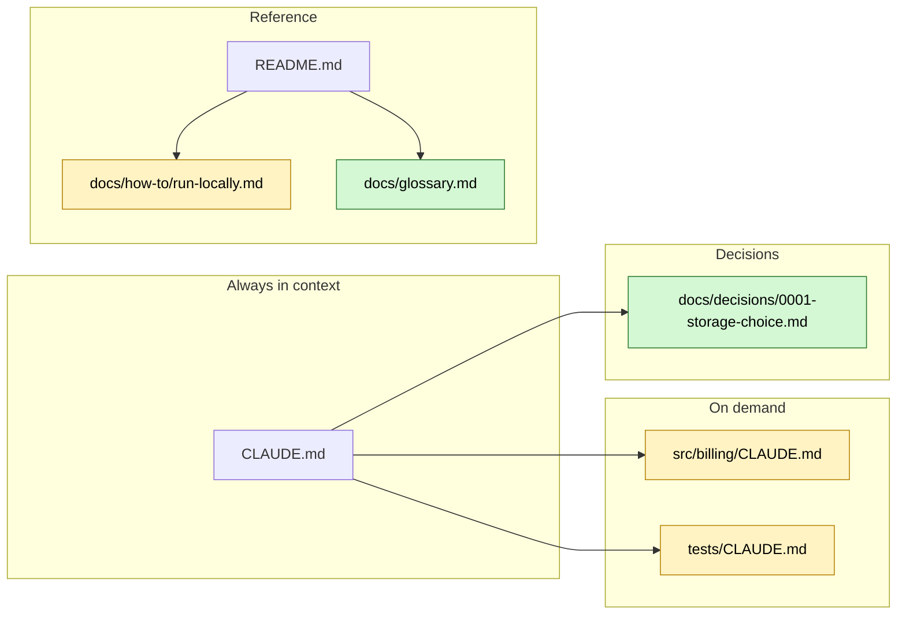

# Report template

## Contents

Report sections in order: Top recommendations; Summary; Recommendations; Skills; What to remove; Checked and fine; Documentation: target structure; Fresh-session test; Commands run; Open questions; Not checked.

File: `harness-audit-<YYYY-MM-DD>.md` in the root of the audited repository. Write the report in the
language of the conversation and translate the section names. Do not delete empty sections: write
"none". Sections in order:

````markdown
# Harness audit — <repository> — <date>

Branch <branch>, commit <sha>. Areas: <all / named>. Claude Code <version>, criteria: 2026-10-17.
What ran: <commands, prompt-audit, /skill-doctor, insights_summary.py; files left in
~/.claude/plans/>. No consent for: <items>.

## Top recommendations

Up to 5 recommendations to start with, from any area, by effect on the person: one line each and a
link to its detailed item below. On a tidy project there may be fewer or none: do not pad to the number.

## Summary

| Area | State | Main gap |
| --- | --- | --- |
| A. Instructions | | |
| B. Spec to code | | |
| C. Verification | | |
| D. Review | | |
| E. Environment | | |
| F. Hygiene | | |
| G. Documentation | | |
| H. Skills | | |
| I. Mechanisms | | |
| J. History | | |
| K. Design before code | | |

Areas that do not apply get a line "not applicable: <why>". There is no overall score.

## Recommendations

### Quick

#### 1. <what to do>

- **Problem:** `path:line` — one sentence. Check ID.
- **Evidence:** what you saw: a quote, a number, command output, session data.
- **Why it matters:** what this breaks in the agent's work; a link to the source.
- **Change:** the file and a snippet; a hook or script in full.
- **Size:** S / M / L.
- **Where:** in repo / personal.
- **Source:** [own analysis] / [prompt-audit] / [doctor] / [skill-doctor] / [insights].

### Medium

### Needs approval

## Skills

### Create

Name, task, evidence, ready `description`, who invokes it, a description in 5–10 sentences, how to
verify. Made later with `skill-creator`.

### Improve

### Install

Source and its tier, the need or a dependency from the manifest, what changes for you, cost in
context, security check, command.

### Worth a look

Popular third-party repositories, up to 5: link, stars, days since the last change, license, why it
fits (need or stack), what changes for you. State that no full security check was done. No install
command.

### Disable

## What to remove

Content derivable from code in `CLAUDE.md`, rules a linter or hook duplicates, unused skills, agents,
plugins, MCP servers: with evidence and the label "in repo" / "personal".

## Checked and fine

ID — one line of evidence.

## Documentation: target structure

| Document | Diátaxis type (convention) | Problem | What to do and why |
| --- | --- | --- | --- |

Structure chosen: <folders by type / folders by area> — <the sign that decided it>.

    <target tree; to the right of each file, where the text comes from: ← README.md: API Reference>

A Mermaid diagram of the same structure, always. Nodes: documents, within the G10 node threshold
(`references/thresholds.md`). Groups: loading
classes. Arrows: where an agent or a person comes to the document from. Colour: new, moved, unchanged;
deleted documents are not drawn. Example:



Folders for later: for each type folder with no document yet, one line: when to create it and why
(`docs-guide.md`, section 2).

What disappears entirely and why.

If the person deletes specs after implementation (step 3), no `docs/archive/`; instead, one row per
spec:

| Spec | ADRs from it (numbers) | Description of working behavior → which document | What to drop |
| --- | --- | --- | --- |

Order for each spec: ADRs and the move first, then deletion, in one PR per spec; different specs go
in different PRs.

ADRs from specs: the full text of each, numbered and ready to save into the ADR folder, one per
decision recorded in a spec or design doc, whether the spec is kept or deleted (`docs-guide.md`,
section 4); or "none: no decisions recorded in specs".

ADRs: what ADRs give this project, in two or three sentences on its example (`docs-guide.md`,
section 4); the folder, the template and the line for the root `CLAUDE.md`; one example ADR in full,
with where it came from (`file:line`) and placeholders where the repository says nothing, or "no
example: no architecturally significant decision found". If the project already keeps ADRs: what to
fix in them.

Glossary: always, unless one exists (G12): the entries found, each with `file:line`, what it means
and the word not to use; how many depends on the project's stage and size; no terms found → the
file with the entry format and the line for `CLAUDE.md`. If one exists: what to fix in it.

### Documentation rules

Whether they exist and where. If they are missing or incomplete, a draft "How to maintain
documentation" section for `docs/README.md` with this repository's real paths, and the texts for
`CLAUDE.md` and the rule.

The PR/MR template — always, when the repository has a remote (`docs-guide.md`, section 7): the full
text of the file for this repository with its path, and the line for the root `CLAUDE.md`. If a
template exists, what to change in it.

## Fresh-session test

| Question | Subagent's answer | Source | Correct? |
| --- | --- | --- | --- |

## Commands run

| Command | Time, s | Exit code | Output lines / bytes | Timeout |
| --- | --- | --- | --- | --- |

## Open questions

Unanswered questions and the recommendations that depend on them; low-confidence `prompt-audit`
findings.

## Not checked

Item — reason: no consent ("not checked — no consent"), no evidence, no data.
````
